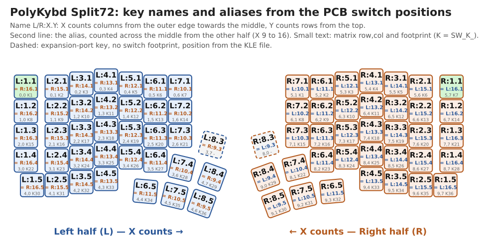

# MCP server for AI assistants: plan

**Status:** version 1 and version 2a built (2026-11-27): `polyhost/mcp/`,
`polyctl mcp`, the key table `res/key_positions.yaml` and `services/key_names.py`;
for 2a `services/key_drawing.py`, `services/user_overlays.py`,
`services/overlay_preview.py` and `gui/user_overlays_dialog.py`. Version 2b (images
per physical key) needs a firmware change and is not built; the entry in [`FUTURE_WORK.md`](FUTURE_WORK.md) says
why it waits. Security record: HOST-9 in `polykybd-ctnd/docs/SECURITY_AUDIT.md`.

## Using it

Start PolyKybdHost (tray or daemon) and turn on *Settings > Connections > Allow AI
assistants (MCP)* (`polyctl settings set mcp_enabled true`). It is off by default.
Then add the server to the AI client. For Claude Code:

```bash
claude mcp add polykybd -- polyctl mcp
```

Any client that starts a local MCP server over stdio takes the same command
(`polyctl mcp`, or `python -m polyhost.mcp` where `polyctl` is not on the `PATH`).
The server starts and lists its tools while the host is not running; each tool then
answers "PolyKybdHost is not running". While the setting is off, each tool answers
that AI assistants are turned off, and names the setting.

## The `mcp_enabled` setting

- **The MCP server names its connection.** Right after the `hello` it sends
  `client.identify {"client": "mcp"}`. From then on `ControlServer.dispatch()`
  refuses every request on that connection with `ERR_MCP_DISABLED` while
  `mcp_enabled` is off. The setting is read on every request, so a change applies
  at once, also to a server that is already running.
- **The host checks the allow-list a second time.** On an MCP connection it refuses
  a method that `tools.ALLOWED_METHODS` does not list, and `settings.get` for any
  other key than `brightness_set_daylight_dependent`, even when the MCP server
  itself did not check.
- **It gates an honest client only.** A connection that does not identify itself
  (`polyctl`, the tray app) is not gated, and a process that can read the authkey
  can open such a connection. The setting stops an assistant that a user added to a
  client; it is not a security boundary against code that runs as the user.
- **A host older than the method** answers "unknown method", and the MCP server
  goes on without the gate: that host has no setting to apply.

## Goal

Let an AI assistant (Claude, ChatGPT, Gemini, Cursor, Codex and others) read and
change the keyboard's state when the user asks in plain language: "switch the
keyboard to Greek", "put mute on the outer left thumb key", "make keys for my
app". The assistant talks to a small MCP server (Model Context Protocol), and the
server talks to the host through the control socket that `polyctl` already uses.

A competing keyboard (Keysible 69, crowdfunding planned for February 2027)
advertises a built-in MCP server with tools such as `set_key_styled`,
`set_key_actions`, `add_key_dynamic`, `build_flow` and `push_to_device`. This plan
does not copy that tool set. It exposes what PolyKybd already does, through the
paths that already exist.

## This is not the agent keys

The agent keys ([`agent-keys-agent-setup.md`](agent-keys-agent-setup.md),
[`agent-registry-plan.md`](agent-registry-plan.md)) show the STATE of AI coding
agents on the number row. They use hooks, not MCP, because an MCP tool runs only
when the model calls it, so it cannot report "waiting for permission". That
reasoning stays valid, and this plan does not change the agent keys. The "MCP shim"
the registry plan lists for later is a different thing: an identity source for
agents without hooks.

This plan is the other direction: the assistant CONTROLS the keyboard, on the
user's request.

## What exists to build on

- **The control socket** (`polyhost/server/protocol.py`, `control_server.py`):
  local only (Unix socket or Windows named pipe), authkey file with mode 0600,
  JSON-RPC, a `hello` version gate. It runs in the daemon and in the in-process
  tray, so the server works in both modes.
- **`RpcClient`** in `polyhost/cli/polyctl.py`: connects with the local endpoint and
  authkey. The MCP server uses it, so it needs no new listener.
- **The `M_*` methods** that already call gated `PolyCore` methods. Each one already
  returns the "firmware too old" error on an older keyboard, so the server adds no
  protocol checks of its own.
- **`res/keycodes.h`** (mirrored from qmk): keycode names for the keymap tools.
- **The overlay pipeline** (`scripts/generate_app_overlays.py`, binding YAML files
  as in `res/overlay_sources/<app>/bindings.yaml`, the icon library in
  `res/fontpack/icon_ids.yaml`). Version 2 uses it.

## Identifying a key

The split72 has no F-row and no printed legends, and the firmware addresses a key by
matrix row and column, which means nothing to the user or the assistant. So every
tool that takes a key resolves a key reference, and two tools describe the board.

- **Every key has a name from its place on the PCB: `L:X.Y` or `R:X.Y`.** `L` is
  the left half and `R` the right half. `X` counts the columns from the outer edge
  towards the middle, and `Y` the rows from the top, both from 1. Examples: Esc is
  `L:1.1`, Tab below it `L:1.2`, and the AI key `R:1.1`.
- **`X` and `Y` come from the switch positions in the KiCad boards**
  (`PolyKybd/poly_kybd/poly_kybd_split72_left.kicad_pcb` and `_right`, footprints
  `SW_K_<n>`), not from the KLE file, because the PCB is the authority for key
  positions ([`layout-editor.md`](layout-editor.md)). `X` is the column nearest
  to the switch (the outer column, then 1.25U to the next, then 1U, 19.05 mm),
  for the rotated thumb keys too. `Y` counts the keys of that column from the top,
  starting at the row nearest to the column's top key: row 1 for columns 1 to 7,
  row 3 for column 8, whose top key is the expansion-port key. So the outer thumb
  pair is `8.4` and `8.5`, not the rows their centres are nearest to.
- **Checked on the current boards (2026-11-27):** the 36 switches of each half get
  36 different names, and both halves give the same set of names, so `L:X.Y` and
  `R:X.Y` are always the same place on each side. The KLE file has 37 keys per
  half; the extra one is `L:8.3` / `R:8.3`, the key over the expansion port, which
  has no `SW_K` switch footprint and no display. The grid, with each key's matrix
  `row,col` (the two halves drawn as they sit on the desk):

  ```
         Left half (X from the left edge)             Right half (X from the right edge)
    Y\X     1    2    3    4    5    6    7    8   |    8    7    6    5    4    3    2    1
      1   0,0  0,1  0,2  0,3  0,4  0,5  0,6    .   |    .  5,1  5,2  5,3  5,4  5,5  5,6  5,7
      2   1,0  1,1  1,2  1,3  1,4  1,5  1,6    .   |    .  6,1  6,2  6,3  6,4  6,5  6,6  6,7
      3   2,0  2,1  2,2  2,3  2,4  2,5  2,6  3,7   |  8,0  7,1  7,2  7,3  7,4  7,5  7,6  7,7
      4   3,0  3,1  3,2  3,3  3,4  3,5  3,6  4,7   |  9,0  8,1  8,2  8,3  8,4  8,5  8,6  8,7
      5   4,0  4,1  4,2  4,3    .  4,4  4,5  4,6   |  9,1  9,2  9,3    .  9,4  9,5  9,6  9,7
  ```

  The cells with `.` have no key. The thumb keys are `6.5`, `7.4`, `7.5`, `8.4`
  and `8.5` on each half.

  
- **Aliases count across the middle.** `X` may go on past 8 into the other half,
  so a key can be named from either side: `L:X.Y` with `X` from 9 to 16 is
  `R:(17 - X).Y`, and `R:X.Y` with `X` from 9 to 16 is `L:(17 - X).Y`. For example
  `L:9.4` is `R:8.4` and `L:10.4` is `R:7.4`. An alias of a place with no key (for
  example `L:12.5`, which would be `R:5.5`) is an error. Tools accept aliases and
  always return the canonical name, the one from the key's own half.
- **The names are a frozen table**, generated once from the boards and shipped
  (`res/key_positions.yaml`, name → matrix `row,col`), not computed at runtime, so a
  later board revision or KLE correction does not rename a key.
  `tests/services/key_names_test.py` compares the table with the KLE file's `row,col`
  labels. When the table was written, every switch's centre was within 4.9 mm of the
  KLE key with the same `row,col` (key pitch 19.05 mm).
- **`list_keys(layer=0)`** returns the 74 keys with, for each key: its name
  (`L:1.1`), the matrix `row` and `col` the control methods use, `thumb`,
  `has_display` (false for the two keys over the expansion ports), and the
  `keycode` on the requested layer and `base` on layer 0, as names.
- **`show_layout(layer)`** returns the grid above with each key's keycode in its
  cell instead of the matrix position, as the shortest QMK name without `KC_`
  (`ESC`, `MO(5)`), like the drawings in the firmware's
  `keymap.c`. An assistant reads positions ("the two keys left of the space bar")
  more reliably from a drawing than from a list.
- **A key reference** in a write tool is one of `"L:1.1"` (or an alias such as
  `"L:9.4"`),
  `{"base": "KC_Q"}` (the key that sends Q on layer 0) or
  `{"row": 2, "col": 3}`. A `base` reference that matches no key, or more than
  one, returns an error that lists the candidates. The server never guesses a key.
- ⚠️ **A keycode is not the legend the user sees.** With a German layout `KC_Y`
  shows Z. The legend for each language is in the firmware's table, which the host
  does not have, so "the key with the Z" resolves only through the assistant
  asking the user, or through a new query (see *Open questions*).
- **Only the split72 has a KLE file.** Until the split42 has one, the key tools
  return an error when `get_status` names a split42.

## Version 1: tools over existing methods

No new HID command, so no protocol version increase. Every tool uses existing
control methods. Three tools also read a file: `list_app_overlays` reads the
shipped overlay mapping file (`res/overlay-mapping.poly.yaml`; there is no user
mapping file yet), and `list_keys` and `show_layout` read the frozen
key table (see *Identifying a key*), which every tool that takes a key also uses
to resolve it.

| Tool | Control method | Kind |
|---|---|---|
| `get_status` | `status.get` | read |
| `list_languages` | `lang.list` | read |
| `get_keymap(layer)` | `keymap.layer_count`, `keymap.buffer` | read, keycodes as names |
| `list_app_overlays` | the overlay mapping file | read, application names only |
| `set_language(lang)` | `lang.set` | write |
| `set_brightness(value \| "default")` | `brightness.set`, `brightness.daylight_refresh` | write |
| `set_idle_style(style)` | `idle.style.set` | write |
| `set_glyph_script(script)` | `glyph.script.set` | write |
| `list_keys(layer)`, `show_layout(layer)` | `keymap.buffer` and the key table | read |
| `set_key(layer, key, keycode)` | `keymap.buffer`, then `keymap.set` | write, stored in EEPROM |
| `set_overlays(enabled)` | `overlay.enable`, `overlay.disable` | write |

- **`set_key` returns the previous keycode**, so the assistant can undo the change.
  `keymap.set` reports only whether the write worked, so the tool reads the key's
  current keycode with `keymap.buffer` right before it writes, and returns that
  value as `previous`. If another client (the layout editor, `polyctl`) changes the
  same key between the read and the write, `previous` is the value the tool read,
  not the one it overwrote; the result says so. The keyboard stores a keymap edit
  in EEPROM at once, so the change survives a restart.
- **The key tools also call `status.get`**, to refuse a split42.
- **`set_brightness("default")` clears a manual brightness** and returns to the
  mode the user configured, as the tray's *Back to automatic* row does
  (`brightness.daylight_refresh`): daylight-dependent brightness when the host
  setting `brightness_set_daylight_dependent` is on, otherwise the keyboard's own
  stored level (`AUTO_OFF`). It cannot switch the daylight mode on: that is a
  setting, and `settings.set` is not exposed. The tool says which mode it
  returned to; to know it, it reads that one setting with `settings.get`, the only
  key the server may read.
- **`get_keymap` returns names** (`KC_A`, `MO(1)`), not numbers, because an
  assistant reads names correctly and numbers it does not.
- **Every write tool has the MCP annotation `destructiveHint` or `idempotentHint`,
  and every read tool `readOnlyHint`**, so the client asks the user before a write
  when it is set to do that.

### Not exposed, on purpose

These methods stay out of the server. The tool list is an allow-list, and a test
fixes it (see *Tests*).

| Methods | Why |
|---|---|
| `fw.flash`, `fw.apply_staged`, `fw.bootloader`, `fw.set_handedness` | can make the keyboard unusable; a firmware update stays a deliberate user action |
| `fontpack.flash`, `fontpack.sync`, `fontpack.wipe`, `doom.install`, `doom.install_pack` | write to flash; `doom.install_pack` sends executable code |
| `update.install`, `host.shutdown` | change or stop the host |
| `keymap.reset` | also erases every macro |
| `commands.execute` | raw command lines, including key injection |
| `settings.set` | some settings open network listeners (`window_report_network_enabled`, `dev_legacy_plaintext_relay`) or change telemetry |
| `overlay.mapping_send`, `overlay.reset_*` | low-level state the matcher owns |
| `window.report`, `agents.*`, `telemetry.*` | other features' inputs |

## Version 2: overlays from a description, and keys drawn freely

**Status:** 2a built (2026-11-27); 2b (per physical key) not built. Two requests:

- "Make keys for my app": an overlay set for one application, from a list of
  shortcuts.
- "Draw this on that key": any picture on one key, with or without the key's
  legend.

Both write the same thing, an overlay set in a user folder, so they share one
pipeline. A drawn key is one binding whose picture the assistant drew.

### What the firmware already does

Nothing in version 2 needs a firmware change or a protocol version increase.

- **An overlay image is 72×40 px, 1 bit**, one per keycode and modifier
  combination (`res/overlay_specification.md`). The firmware draws the legend
  first, cuts a 3 px margin around the image's ink out of it, and draws the image
  on top (`copy_overlay_to_buffer()` in qmk `keys_com/key_render_helpers.c`).
- **"Without glyph" exists since protocol v25.** A key listed in the overlay file's
  `polykybd-no-legend` PNG chunk is drawn with the image only: the firmware clears
  the whole keycap first. The generator writes the chunk for a binding with
  `legend: false` (`scripts/generate_app_overlays.py`), and the send path passes it
  to `send_overlay_mapping(no_legend=...)`. On firmware older than v25 the legend
  stays.
- ⚠️ **An overlay belongs to a KEYCODE, not to a physical key.** An image for
  `KC_ENT` shows on every key that sends Enter on the active layer. Only 90
  keycodes have an overlay slot: the letters, digits, F1 to F12, the navigation and
  editing keys, the punctuation keys and the eight modifiers. A key that sends
  `MO(5)`, `TO(12)` or a PolyKybd keycode (`0x7FA8`) cannot get an image. Images
  per physical key would need a new firmware slot table; that is not in this plan.
- **An overlay shows only while its app is focused**, chosen by the window matcher
  from `overlay-mapping.poly.yaml`. One switch shows at most 600 distinct images
  (`OVERLAY_POOL_CAPACITY`).

### The pieces

1. **A user overlay folder**, `user_overlays/` in the config directory, with one
   subfolder per set: `set.yaml` (app, bindings) and the drawn PNGs
   `user_<app>.mods.png` (and `.combo`, `.extra`, `.gui`), written by
   `services/user_overlays.py` with the no-legend chunk. The `"*"` set is the folder
   `_all`. No separate user mapping file: the sets themselves are the mapping.
2. **The merge.** At load and after every change, `merged_mapping()` lays each set
   over the shipped entry for its app: its files (absolute paths) are appended to
   every `overlay` list of the entry, its URL, title and OS routes included. An app
   with no shipped entry gets a new one. The send keeps the LAST image per key and
   modifier (`send_overlays_mru`, "a later source wins a key"), so the files go out
   in this order: the `"*"` set, the shipped set, the user's set for the app.
   `PolyCore._with_star_set()` puts the `"*"` set in front of all three sends (the
   template send, the generic set and its clear). Where a window has no overlay, the
   core sends the `"*"` set alone instead of a DISABLE, and a changed set is sent at
   once rather than at the next app switch. The generic icons skip the keys the
   `"*"` set draws, because it is a real source and they are synthetic ones. The tools write only
   the entries they created (each carries `source: mcp`) and leave every other
   line of the file as it is. A user who edits the file by hand keeps their edits.
3. **New control methods in the host** (`user_overlay.list`, `.get`, `.set`,
   `.clear`, `.preview`). The host, not the MCP server, checks the request, writes
   the files, runs the generator in-process and reloads the mapping, so
   `mcp_enabled` and the allow-list apply to every write, and a change shows at the
   next window switch, or at once when the app is focused. The MCP server writes no
   file.
4. **The tools** below.

### Tools

| Tool | What it does |
|---|---|
| `find_icons(query)` | Searches the icon library names (`res/fontpack/icon_ids.yaml`, 3556 entries such as `concept:material:content_copy`) and returns up to 20, each with its size in pixels. |
| `list_overlay_keys()` | The 90 keys that can have an image, by key name, and which physical keys send each one on layer 0. |
| `create_overlay(app, bindings)` | Writes or replaces the user set for `app`. `bindings` is a list of `{key, drawing, mods, legend}`; a label or an icon is a `text` or `icon` shape. Returns the placed keys; any refused binding refuses the whole call, with the reason. |
| `list_user_overlays()` | The user's sets, by app, with their key counts. |
| `draw_key(app, key, drawing, mods=[], legend=true, follow="keycode")` | Adds or replaces one binding in the user set for `app` (`"*"` for every app, see below) and regenerates it. `follow` applies to `"*"` only. |
| `clear_key(app, key, mods=[])`, `delete_overlay(app)` | Remove one binding, or the whole user set and its mapping entry. Only sets in `user_overlays/` can be removed. |
| `preview_overlay(app, mods=[])` | Both halves with every key's image at 2× scale, as an MCP image, with the keycode name on keys that have no image. A key drawn with its legend is marked, and the cut the firmware makes into the legend is shown as a 3 px outline. |

- **`key`** is a key reference as in version 1 (`"L:3.2"`, `{"base": "KC_Q"}`) or a
  keycode name (`"KC_F5"`). A physical key resolves to its keycode on layer 0. The
  result names every other physical key that sends the same keycode, because the
  image shows there too.
- **`legend`** false draws the picture without the key's legend.
- **`app`** is a name from `list_app_overlays`, or any process name the window
  matcher sees (the lowercased name up to the first dot).

### The drawing format

The assistant describes the picture; the host draws it on a 72×40 1-bit canvas with
PIL, which is a runtime dependency on every platform. A drawing is a list of
shapes, drawn in order:

```json
[
  {"rect": [0, 0, 72, 40], "fill": false, "width": 2},
  {"line": [6, 34, 66, 6], "width": 3},
  {"ellipse": [24, 8, 24, 24], "fill": true},
  {"polygon": [[36, 4], [60, 36], [12, 36]], "fill": false},
  {"text": "F5", "at": [36, 20], "size": 18, "align": "center"},
  {"icon": "concept:material:content_copy", "at": [44, 12]},
  {"bitmap": ["..##..", ".####.", "######"], "at": [0, 0], "scale": 2},
  {"erase": true, "rect": [30, 0, 12, 40]}
]
```

- Coordinates are pixels, `[0, 0]` at the top left. `rect` and `ellipse` take
  `[x, y, w, h]`. Every shape is clipped to the canvas; a shape outside it draws
  nothing and the result says so.
- `text` is drawn with Pillow's built-in scalable font (Aileron, Pillow 10.1 or
  newer, `ImageFont.load_default(size)`), without anti-aliasing. It is the same on
  every platform and needs no file. It has Latin letters only: Greek, Cyrillic or
  CJK text draws as boxes, and the tool refuses it. The keyboard's own Latin faces
  are compiled into the firmware and are not in the shipped font packs, so the host
  cannot draw with them without a qmk_firmware checkout.
- `icon` draws one of the 3556 icons of the shipped icon library
  (`res/fontpack/icons.plyi`, named in `icon_ids.yaml`, read with
  `services/icon_library.parse()`), at its own size. `at` moves its top-left
  corner; without `at` it stays where the library puts it. An icon left in its
  library position is a library frame, so the keyboard draws it from its own flash
  and it costs no upload. Icons are not scaled: a scaled 1-bit icon loses lines.
- `bitmap` is rows of `#` and `.`, for exact pixel art.
- `"erase": true` draws in black, to cut a gap into earlier shapes.
- **Why a shape list, not SVG:** the host's SVG rasteriser
  (`services/svg_raster.py`) draws only flat `<path>` icons, without strokes or
  text, and `cairosvg` does not install on Windows. A shape list renders the same
  on every platform, and every shape is a call the host checks.
- **Limits:** at most 200 shapes, 2000 points in total and 64 characters of text per
  drawing; a `bitmap` is at most 40 rows of 72 columns.
- With `legend` true, the firmware cuts a 3 px margin around the drawing's ink out
  of the legend. A drawing that fills the key leaves no legend; the preview shows
  that cut. The preview cannot show the legend itself: the host has neither the
  firmware's Latin faces nor the legend table of each language (see *Identifying a
  key*).

### Every app, or one app

- **An app's set follows the keycode**, as every overlay does today.
- **The `"*"` set holds drawings for every app.** The host adds it to every overlay
  send: the focused app's images first (shipped and user), then the `"*"` images on
  the keys they leave empty. With no app matched, the `"*"` set is the only one.
- **A `"*"` drawing chooses how it is addressed**, with `follow`:
  - `"keycode"` (version 2a): like an app overlay. It shows on every key that sends
    that keycode, on any layer, and works on today's firmware.
  - `"key"` (version 2b): on one physical key, whatever it sends, on any layer, also
    on a key that sends `MO(5)` or a PolyKybd keycode. It needs the firmware change
    below.

### Version 2b: images per physical key (firmware)

Today the firmware finds a key's image by keycode: `copy_overlay_to_buffer()` turns
the keycode and the held modifiers into one of 810 display positions, and
`display_to_pool[]` (set by cmd 33, bridged to the other half, repaired after a lost
bridge report) turns that into one of the 600 pool images. A physical key has no
entry in that chain.

- **A second, small table:** for each of the 74 physical keys, a pool slot or none,
  and a no-legend flag. A new HID command sets and clears it, version-gated
  (`FEATURE_MIN_PROTOCOL`, a protocol version increase on both sides, the
  `add-gated-hid-command` skill). The master bridges it to the other half like the
  overlay mapping and repairs it the same way after a lost report.
- **Drawing order in `update_displays()`:** the keycode image first, as today. When
  the keycode has none, the physical key's image. So an app's own icon stays on top,
  as for keycode drawings.
- **One image per physical key, in every modifier state** where the keycode has no
  image. Per-modifier images per physical key would need 74 × 16 entries; nobody has
  asked for that.
- **The images use the same pool and upload path.** The host's MRU claim pass must
  reserve their slots, and the send loop must agree with it
  (`tests/device/mru_claim_test.py`): the rule in the host rules file.
- **The host decides by protocol:** on older firmware a `follow: "key"` drawing is
  refused with the firmware version it needs, not drawn by keycode instead.

Version 2a is built first. 2b needs a firmware release, then the host release.

### Rules

- This is per-application configuration that the user asked for. It does not change
  the rule of [`generic-icons-plan.md`](generic-icons-plan.md): the automatic
  shortcut harvest still uses no per-application configuration.
- The tools write only inside `user_overlays/`, with file names the host makes from
  the app name (letters, digits, `-` and `_`; anything else is refused). They read
  no file the assistant names and download nothing.
- `mcp_enabled` gates these tools like the others. New control methods go on the
  allow-list, and the frozen test changes with them.

### Decided (2026-11-27, maintainer)

- An app's set follows the keycode. A `"*"` drawing chooses `follow: "keycode"` or
  `follow: "key"`; the second waits for version 2b.
- The `"*"` set is wanted.
- A user set for an app that has a shipped set is laid OVER it: the user's keys
  first, the shipped images on every other key.
- The tray gets a page that lists the user sets, with Remove. Built as a dialog,
  *Overlays made by AI assistants…* in the tray menu, not as a Settings page:
  `tests/gui/settings_dialog_test.py` allows no push button in Settings besides OK,
  Cancel and Generate.

## Not planned: live values on keys

Keysible shows live data on keys (CPU temperature, stock prices, song lyrics). On
PolyKybd that means the host uploads a new image for a key every few seconds. One
72×40 image is about 30 bytes compressed and one HID report, so a few keys at
about 1 update per second would fit. It is left out of this plan because the
overlay send path, the 600-image pool (`OVERLAY_POOL_CAPACITY`) and the MRU claim
pass are built for whole-app switches, not for single keys that change all the
time. It needs its own plan, with a measurement on hardware.

## Process and transport

- **Started by the AI client over stdio**, the usual way for a local MCP server:
  `polyctl mcp`, or `python -m polyhost.mcp`. For Claude Code:
  `claude mcp add polykybd -- polyctl mcp`. The server opens no port.
- **It needs a running host** (daemon or tray). Without one, every tool returns
  "PolyKybdHost is not running", and the server still starts, so the client shows
  the tools.
- **`polyctl` stays stdlib-only.** The server lives in its own module, and
  `polyctl mcp` imports it only when called.

## Security

- **The trust boundary does not move.** The server uses the local authkey, so it
  can do only what `polyctl` can do for the same user, and less, because of the
  allow-list.
- **The new risk is prompt injection.** Text the assistant read elsewhere (a web
  page, a file, an issue) can make it call a tool the user did not ask for. The
  allow-list keeps the worst case small: a changed language, brightness or key,
  all reversible. No tool reaches the firmware, the flash or a network setting.
- **Results are an allow-list too**, built field by field like the telemetry
  payload (`build_payload()`), never by passing a status dict through. Window
  titles, URLs, agent session titles and file paths are never returned.
  `status.get` has none of them today, and the field list keeps it that way when it
  grows.
- **Recorded in `polykybd-ctnd/docs/SECURITY_AUDIT.md` as HOST-9.**

## Tests

- **A frozen allow-list test**: the set of tools and the control methods they reach,
  compared with a fixed list, so adding a method to the server fails until the test
  is changed on purpose (the same pattern as the frozen `PAYLOAD_KEYS` test in
  `tests/services/telemetry_test.py`).
- **A test per excluded method**: calling it through the server is refused.
- **Tool tests against the mock keyboard** (`dev_mock_primary`) through a real
  `ControlServer`, as `tests/server/control_server_test.py` does. Each tool's
  control methods are recorded and must be a subset of its allow-list entry.
- **A result-field test**: no tool result has a key outside its field list.
- **A key-identification test**: the frozen table has 74 different names, every
  `row,col` of the KLE file exactly once, and the same set of names on both halves;
  every alias resolves to the same key as its canonical name, and an alias of an
  empty place is an error; a `base` reference to a keycode that is on two keys returns an error, not one of
  them.
- **One run with a real MCP client** before merging, per the repo rule to run the
  real entry point once.

## Open questions

Decided on 2026-11-27 by the maintainer: the server is a stdlib implementation
(`polyhost/mcp/server.py`: `initialize`, `ping`, `tools/list`, `tools/call`, protocol
versions 2024-11-05 to 2025-11-25), not the `mcp` SDK, which would add pydantic,
anyio, httpx and starlette to every install. `set_key` is in version 1. A host
setting turns the server off, and it is off by default (`mcp_enabled`, see above).

1. **Which clients to document**, and whether a `polyctl mcp install <client>`
   command writes their config files, as `polyctl agents hooks install` does for
   the agent hooks.
2. **The name of a user overlay that equals a shipped one.** The resolver order
   above uses the user's file; a warning in the log may be enough.
3. **The names for the split42.** Its boards give the same scheme; it needs its
   own KLE file and its own frozen table before the key tools support it.
4. **The legend a key shows in the current language.** The host can read it only
   through a new HID query (version-gated, a firmware change). Without it the
   assistant works with keycodes and asks the user when the language matters.
