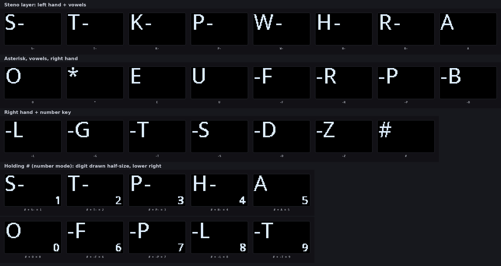
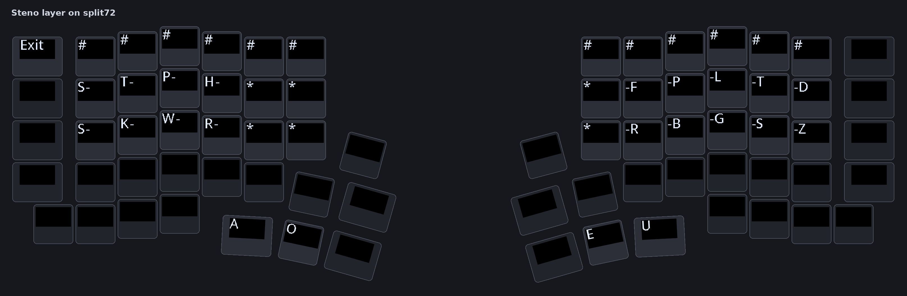
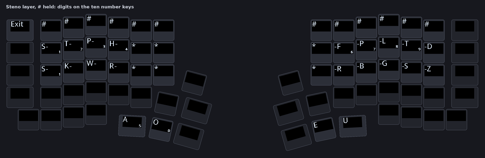

# Steno macros: plan

**Status:** designed, not built (2026-11-10). Nothing in this file exists in the
firmware or the host yet. It records the design and the facts it was checked
against, so the work can start from here instead of from zero. The decision to
build it is open; see [What has to be decided](#what-has-to-be-decided).

A **steno macro** is a key that presses a stored set of steno keys at once, a
whole chord, and shows a label of its own on the keycap. The user sets the chord
and the label in the host. Plover receives the chord exactly as if the fingers had
pressed those keys together, so a steno macro can send any stroke the user's Plover
dictionary knows: a command (`PHROLG` toggles Plover), a brief (`THAPBG` for
"thank you") or part of a longer chord.

This depends on base steno support, which also does not exist yet. Both are
described here, because the steno macros reuse every part of it.

---

## Background in short

[Plover](https://www.openstenoproject.org/plover/) is the open-source steno
program. The user presses several keys at once (a chord); when the last key is
released, the keyboard sends the chord as one stroke, and Plover looks the stroke
up in its dictionary and types the word. A steno machine has 23 keys plus a
**number bar** (`#`): holding `#` turns ten keys into the digits 0 to 9.

QMK has three ways to talk to Plover (`docs/features/stenography.md` in
qmk_firmware):

| Way | How | Fit for PolyKybd |
|---|---|---|
| Plover's keyboard mode | Plover reads normal key presses (needs NKRO) | Works today, no firmware change. Plover must be switched on and off. |
| GeminiPR / TX Bolt (`STENO_ENABLE`) | steno strokes over a virtual serial port (`VIRTSER_ENABLE`) | **No.** The bulk pipe already uses the board's one virtual serial port. |
| **Plover HID** (`PLOVER_HID_ENABLE`) | a separate USB HID interface, a 64-bit field of pressed buttons | **Yes.** Needs Plover 5.1 or later. |

Checked on 2026-11-09: split72 with `PLOVER_HID_ENABLE=yes` compiles and links,
the USB endpoints fit, and the image grows by 432 B of `.text` and 132 B of
`.data`. Plover HID and `STENO_ENABLE` cannot be used together (QMK disables Plover
HID when `STENO_ENABLE` is set, `builddefs/common_features.mk`).

---

## Part 1: base steno (prerequisite)

### Firmware

- `PLOVER_HID_ENABLE = yes` in both variants' `rules.mk`.
- A **steno layer** in the default keymap, reached from the settings layer with a
  `TG()` key. A new layer changes stored layer numbers: add it after the existing
  layers so no stored layer moves, and check `KEYMAP_LAYERS_FL_MERGED` and the
  `DYNAMIC_KEYMAP_UPDATE_MAX_LAYER_COUNT` cap of 8 (`KEYMAP_STORAGE.md`). A layer
  above the cap is served from flash and cannot be edited by the user.
- **Legends for the 42 QMK steno keycodes** (`QK_STENO`, 0x74C0..0x751F; the
  Plover HID extras `ST_X1`..`ST_X14` among them). Today nothing in
  `keyboards/polykybd/` handles this range, so a steno key would draw no legend.
  Add a `case` range in `to_static_text()` / `keycode_to_static_text()` with a
  string table, and keep `render_key()` and `to_static_text()` in step.

The legends were rendered with the `keycap-layout-preview` skill's model
(`keycap_preview.py`), including the per-glyph 3 px courtyard clear:

- Left-hand keys are `S-` `T-` `K-` `P-` `W-` `H-` `R-`, right-hand keys `-F` `-R`
  `-P` `-B` `-L` `-G` `-T` `-S` `-D` `-Z`, then `A` `O` `E` `U` `*` `#`.
- In `S-` the hyphen's courtyard removed 5 px of the S. One `\x06` (move the cursor
  2 px right) before the hyphen fixes it; use it in all seven left-hand legends so
  their spacing matches. After that, every legend draws the same number of pixels
  with the courtyard as without it.
- **Number mode:** while `#` is held, the ten number keys show their digit half
  size (`HINT_SMALL`), 2 px from the right and bottom panel edges. No digit touches
  its letter and nothing is outside the 72x40 panel.

### The layout on split72

| Position | Steno key |
|---|---|
| Number row, both halves | `#` (all 13 are the number bar; Plover maps every `ST_Nx` to `#`) |
| Left top and home row, columns 1 to 4 | `S-` · `T-`/`K-` · `P-`/`W-` · `H-`/`R-` |
| Left columns 5 and 6, right column 1 | `*` (6 keys) |
| Right top and home row, columns 2 to 6 | `-F`/`-R` · `-P`/`-B` · `-L`/`-G` · `-T`/`-S` · `-D`/`-Z` |
| Left thumbs (Space, Del) | `A`, `O` |
| Right thumbs (/, Space) | `E`, `U` |
| Escape | `Exit` (leaves the layer) |

The images use the key positions from `res/polykybd-split72.json` (through
`services/board_layout.physical_keys()`) and the same keycap model as above. A
steno user should review the vowel thumb keys before this is fixed: the thumb arc
is angled, and the three inner thumb keys may suit better.

### Host

- The 42 `ST_*` keycodes in the layout editor's keycode browser. They are QMK
  keycodes, so their names are already in the mirrored `res/keycodes.h`.
- The steno legends in `res/preview/legends.json`
  (`scripts/export_preview_data.py`), so the editor shows the same legends as the
  keycaps.
- No protocol change: Part 1 adds no HID command.

---

## Part 2: steno macros

### What the user does

1. In the layout editor, open the new **Steno** tab (next to **Macros**).
2. Pick a steno macro slot. Build the chord by clicking keys on a small steno
   keyboard, or type it in Plover's notation (`PHROLG`, `TK-LS`, `#ST`).
3. Optionally give it a label, a style and an icon, as for a normal macro.
   Without a label, the keycap shows the chord in steno notation.
4. Put the steno macro's keycode on any key, normally on the steno layer.

From the CLI: `polyctl steno macro set 0 --stroke PHROLG --label Plover`.

Examples that work with Plover's default dictionaries:

| Label | Chord | Plover does |
|---|---|---|
| Plover | `PHROLG` | toggle Plover on and off |
| Cap | `KPA` | capitalize the next word |
| No space | `TK-LS` | no space before the next word |
| ¶ | `TP-PL` | new paragraph |
| Lookup | `PHR*UP` | open the lookup window |

Undo needs no steno macro: it is `*`, which the layer already has.

### Behaviour

- **Press:** set every button of the chord in the Plover HID report.
- **Release:** clear those buttons, except the ones another held key still holds.
- **Alone:** Plover receives exactly the stored chord as one stroke.
- **Held with other steno keys:** the buttons merge into the current chord. A steno
  macro for `#` + `S-`, held with `T-`, gives the stroke "12".

⚠️ **QMK keeps one bit per button and no counter.** `plover_hid_update(button,
pressed)` in `quantum/plover_hid.c` sets or clears the bit directly, and
`process_plover_hid()` calls it for each steno key. If a steno macro released
`S-` while the physical `S-` key is still held, the bit would be cleared too early
and Plover would see a different chord. The firmware must keep its own count of
holders per button (one byte per button, 58 buttons) and call
`plover_hid_update()` only on the change from 0 to 1 and from 1 to 0. That means
the physical steno keys also go through the counter, not through QMK's
`process_plover_hid()` directly.

### Firmware

**Keycodes.** Eight new custom keycodes, `KC_STN_M0`..`KC_STN_M7`.

⚠️ They cannot be appended at the end of `enum my_keycodes` in
`keycode_helper.h`. The end of the enum is the `KCL_` language tail, generated by
cog, which grows when a language is added; anything after it would move, and a
stored keymap would then point at a different key. They need their own block at a
fixed value, with a `static_assert` that it does not overlap the other blocks. The
host's positional enum parser knows only the anchors `QK_KB_0` and `QK_USER_0`
(`_KEYCODE_ANCHORS` in `gui/layout_dialog/keycap_preview.py`) and must learn the
new one.

**Record.** One record per steno macro, 25 bytes:

| Field | Size | Content |
|---|---|---|
| chord | 8 B | bit field over the Plover HID buttons, bit n = `PLV_BTN_*` index n (`quantum/plover_hid.h`, 58 buttons including `X1`..`X14`) |
| look | 17 B | the macro look: style 1 B, icon 4 B, label 12 B (`POLY_MACRO_LOOK_LEN`) |

An all-zero record is an empty slot. An unwritten EEPROM byte reads 0x00 after wear
levelling, so a board that never stored one sees eight empty slots.

**Storage.** Measured on 2026-11-10 from the split72 build flags:

| Region | Address | Size |
|---|---|---|
| EEPROM in total | | 4096 B |
| Macro bodies (QMK's buffer) | 1637 | 2187 B |
| Macro looks (16 x 17 B) | 3824 | 272 B |

Eight steno macro records take 200 B. They go **between** the bodies and the
looks: the body region shrinks by 200 B to 1987 B, and the looks keep address 3824.

⚠️ Today `POLY_MACRO_LABEL_ADDR` is defined as the end of the body region
(`config.h`), so shrinking the body region would move the looks too, and every
board's macro labels would be read from the wrong place. Define the look address
from the top of EEPROM instead (`DYNAMIC_KEYMAP_EEPROM_MAX_ADDR + 1 -
POLY_MACRO_LABEL_BYTES`) before adding the steno region, and assert that it is
unchanged (3824 on split72).

⚠️ **The 200 B were macro body space before.** A board whose bodies use more than
1987 B loses the end of its last macros, and the steno region starts out holding
macro text. On the first boot of the new firmware:

1. Read a format byte for the steno region (new, at its start or in
   `poly_eeconf_t`). If it is not the new value:
2. If the bodies use more than 1987 B, cut the buffer at the last whole macro that
   fits and print one console line naming the macros that were lost.
3. Zero the 200 B and write the format byte.

The host can warn before the firmware update: `polyctl macro list` already reports
how much of the body buffer is used.

**Keycap.** A steno macro key draws its look with the existing macro keycap code
(`poly_macro_look_get()` and the macro legend path). An empty label shows the chord
in steno notation. To keep the notation code in one place, the host writes the
notation into the label when the user leaves the label empty; the firmware then
needs no notation code. A record with neither label nor icon draws `St0`..`St7`.

**Split sync.** The slave draws the keycaps, so it needs the look and, for the
notation, the chord. Reuse the macro look sync: `poly_macro_label_sync_tick()`
sends one dirty record per housekeeping pass and clears the dirty bit only on a
real acknowledgement (`sync_succeeded()`). A 25-byte record fits the RPC buffer
(`RPC_M2S_BUFFER_SIZE` 252). Only the master uses the chord for key handling.

**HID command.** One new command, `STENO_MACRO` (cmd 45 if still free), behind a
new protocol version (30 if still free; 29 is tap-hold timing). Check both numbers
against `config.h` and `PROTOCOL_HISTORY.md` when the work starts.

| Byte | Request | Reply |
|---|---|---|
| 2 | op: 0 info, 1 get, 2 set | ACK/NACK |
| 3 | slot (get, set) | for info: slot count (8) |
| 4..11 | chord (set) | chord (get) |
| 12..28 | look (set) | look (get) |

Set validates the slot, then the look exactly as cmd 38 does, then writes. The
record is written to EEPROM at once, like the macro looks, not at the next settings
flush. A chord bit at or above `PLV_BTN_COUNT` is refused.

### Host

Follow the `add-gated-hid-command` skill:

- `Cmd.STENO_MACRO`, `STENO_MACRO_MIN_PROTOCOL`, the `FEATURE_MIN_PROTOCOL`
  entry, `get_steno_macro()` / `set_steno_macro()` / `steno_macro_info()` on
  `PolyKybd`, the mock (`poly_kybd_mock.py`, `mock_firmware.py` with
  `CMD_MIN_PROTOCOL`), `PolyCore`, the control-socket methods, `RemoteCore`, and the
  entries in both protocol sweep tests.
- **Notation:** a Qt-free module (for example `polyhost/services/steno.py`) that
  converts between the 8-byte chord and Plover's notation. Steno order is
  `# S T K P W H R A O * E U F R P B L G T S D Z`; a hyphen separates the left and
  right halves when no vowel or `*` is in the chord (`TK-LS`), and a leading `-`
  marks a right-only chord (`-D`). `S1`/`S2` both mean `S-`, `ST1`..`ST4` mean `*`,
  `N1`..`NC` mean `#`; the parser writes the first of each. Test it against
  Plover's own examples.
- **Layout editor:** a Steno tab built from the Macros tab's parts
  (`gui/layout_dialog/macro_tab.py`, `macro_keycap_render.py`,
  `macro_icon_dialog.py`), a steno key picker, and the notation field. Reads and
  writes go off the GUI thread (`MenuFetcher`, see `CLAUDE.md`).
- **Keycode browser:** the eight `KC_STN_M*` keycodes, named from the record's
  label.
- **`polyctl steno macro list|get|set|clear`.**
- **i18n:** every new tray and editor string through `_()`, the catalogs updated,
  `list_untranslated.py` at 0.

### Tests

- **Firmware unit tests** (gtest, `base/tests/`): the holder counter (macro and
  physical key on the same button, release order both ways), the record
  validation, and the format-byte migration including a body buffer that is too
  full.
- **Host:** wire bytes of cmd 45 in `poly_kybd_cmd_test.py`, the gate in
  `poly_kybd_capabilities_test.py`, the notation round trip, the mock round trip,
  and the editor tab under `xvfb-run`.
- **HIL** (`polykybd-ctnd`, the `add-hil-test` skill): set, get and clear every
  slot; refuse a slot past the count and a chord bit past `PLV_BTN_COUNT`; the
  power-cycle check reads one record back. The rig cannot press keys, so it cannot
  check the stroke Plover receives.
- **On hardware with Plover 5.1+:** a steno macro alone, held with other steno
  keys, and pressed while the same physical steno key is held.

---

## What has to be decided

1. **Whether to build steno at all.** Nobody on the project uses steno yet. Ask
   the Plover community (Discord, the Open Steno Project forum) to review the
   layout images above before writing firmware.
2. **The number of steno macros.** This is a new limit, so the maintainer decides
   it. 8 records cost 200 B of macro body space (2187 B → 1987 B, 9 %); 16 cost
   400 B (→ 1787 B, 18 %).
3. **Built-in chords first, or only configurable ones.** A smaller first step is a
   few steno macros with fixed chords and fixed legends compiled into the firmware
   (the table under [What the user does](#what-the-user-does)). They need no
   storage, no HID command and no protocol change, and they use the same holder
   counter and keycap code. The configurable version can be added after them
   without changing them.
4. **The `ST_X1`..`ST_X14` extras.** A steno macro can send any stroke, including
   Plover's commands, so the extras may not be needed in the default layout.

## Order of work

1. Base steno (Part 1): firmware and host keycode names, no protocol change.
2. Built-in steno macros (decision 3), in the same firmware PR or the next one.
3. Configurable steno macros (Part 2): firmware, host and rig PRs together, with
   the protocol increase on both sides, published host first.
